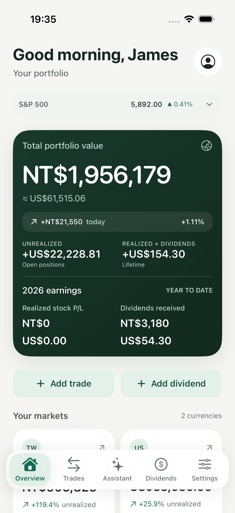
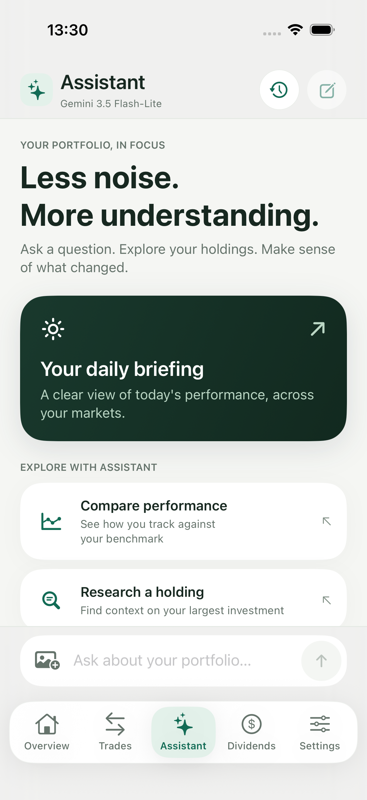
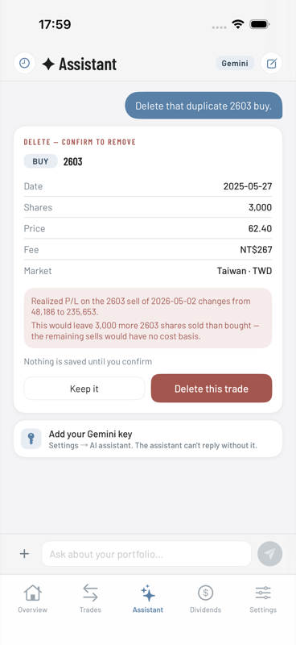
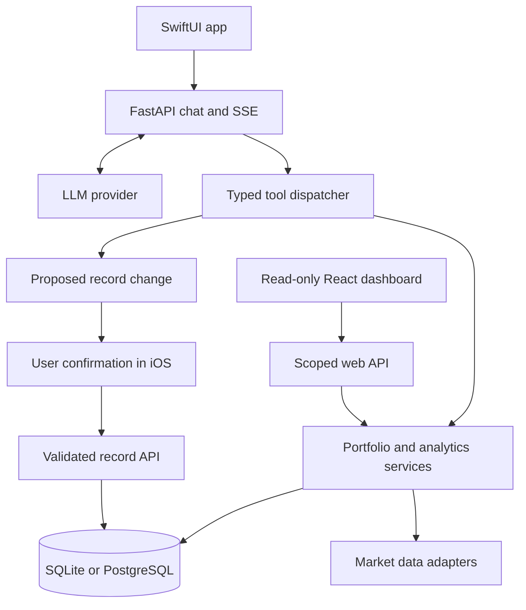

<div align="center">

# AI Stock Studio

**A portfolio-aware AI assistant backed by real account calculations.**

Track Taiwan and US equities through a native iOS app and a responsive web dashboard, with a shared FastAPI backend for portfolio accounting, market data, and agent tools.

[](https://github.com/jimmy19981226/stock-tracker/actions/workflows/ci.yml)


[Product tour](#product-tour) · [AI architecture](#ai-architecture) · [Run locally](#run-locally) · [Tests](#verification) · [Documentation](#documentation)

</div>

## Product tour

<p align="center">
  
  
  
</p>
<p align="center"><em>Track a portfolio → ask a question → review a proposed change.</em></p>

**Team project.** AI Stock Studio was developed collaboratively. This repository presents the shared system, with implementation credit belonging to its contributors.

AI Stock Studio brings holdings, trades, dividends, market data, and AI assistance into one self-hosted application. The engineering focus is keeping financial calculations in application services while allowing a language model to query those services and explain their results.

| Capability | Implementation |
| :--- | :--- |
| **Grounded assistance** | Typed portfolio tools, account-scoped reads, complete filtered totals, and checks on supported numeric answers |
| **Controlled record changes** | The assistant drafts an action; the iOS app requires confirmation before submitting the write |
| **Two-market accounting** | Taiwan/US holdings, TW moving-average / US FIFO cost basis, realized/unrealized P&L, dividends, and currency conversion |
| **Time-aware analysis** | Dated performance windows, benchmark comparisons, and explicit handling of unavailable history |
| **Multiple clients** | SwiftUI app, WidgetKit snapshot, and a read-only React dashboard |
| **Report generation** | Shared calculation services feed local PDF rendering or optional Adobe document templates |

[Explore all features](docs/FEATURES.md) · [See the screenshot gallery](docs/GALLERY.md)

## AI architecture



**Read → calculate → explain.** The assistant can request holdings, filtered records, purchase lots, performance, fundamentals, and reports. The backend performs account arithmetic and returns structured results. This makes the calculation path inspectable independently of model output.

**Propose → review → commit.** Tool-generated writes are proposals. Confirmation cards let the user review additions, corrections, deletions, and imports before ordinary record endpoints persist them.

**Stream → reconnect.** Server-side chat runs stream status and response events to iOS, with persisted chat history and support for background completion. Regression tests exercise the transport, tool execution, data scoping, and calculation paths with synthetic account data.

The iOS client currently selects Gemini; the backend also contains provider adapters. Provider availability, model output, and market feeds remain external dependencies. The tests establish specific application behaviors, not a guarantee that every generated answer is correct.

## Run locally

### Backend

Use **Python 3.11+**. SQLite is the default; a PostgreSQL connection is optional.

```bash
git clone https://github.com/jimmy19981226/stock-tracker.git
cd stock-tracker/backend
python -m venv .venv
source .venv/bin/activate
python -m pip install -r requirements-dev.txt
cp .env.example .env
# Edit .env and set WEB_DASHBOARD_PASSWORD to a password of your choice.
python -m uvicorn app.main:app --reload --port 8011
```

On Windows, activate with `.venv\Scripts\Activate.ps1`. Open the [local API explorer](http://127.0.0.1:8011/docs) or check `GET /api/health`. A fresh local database starts empty. Add your own records through the iOS client or the API explorer.

### Web dashboard

In another terminal, from the repository root:

```bash
cd frontend
npm ci
npm run dev
```

Open **http://localhost:5173** and enter the dashboard password. Vite forwards `/api` requests to `http://127.0.0.1:8011`. The web client reads the account scope configured by `WEB_DASHBOARD_USER_ID`, which defaults to `legacy`.

### iOS and optional AI

Generate the project with XcodeGen, open it in Xcode, and set the app's backend URL to your own instance before entering records. The repository's existing app configuration includes a hosted default URL. See the [iOS setup guide](ios/README.md).

Portfolio tracking can run without an AI provider key. In iOS Settings → AI assistant, choose Included AI for the server-managed Gemini connection, or Personal key to use your own key. Switching to Included AI preserves your saved key but does not send it. Follow the backend environment example to configure server-managed access. Request content used by AI features is sent to the selected provider.

## Verification

```bash
# From backend/, with the development dependencies installed:
python -m unittest discover -s tests -v

# From frontend/:
npm ci
npm run build
```

The backend suite covers account isolation, tool calls, confirmation proposals, image handling, exact dated returns, malformed credentials, Unicode passwords, and token expiry/rotation. Ordinary runs skip the explicitly opt-in live Gemini tests. CI runs the backend tests and a clean web build; native iOS tests require Xcode.

## Code guide

| Start here | What to inspect |
| :--- | :--- |
| [`ai_tools.py`](backend/app/services/ai_tools.py) | Tool schemas, dispatch, and proposed actions |
| [`ai_analytics.py`](backend/app/services/ai_analytics.py) / [`ai_answers.py`](backend/app/services/ai_answers.py) | Filtered analysis and supported numeric answer checks |
| [`ai.py`](backend/app/routers/ai.py) | Chat lifecycle, streaming, and provider integration |
| [`portfolio.py`](backend/app/services/portfolio.py) / [`performance.py`](backend/app/services/performance.py) | Market-specific accounting and dated performance calculations |
| [`backend/tests/`](backend/tests/) | Integration tests with isolated databases and stubbed external services |
| [`ios/`](ios/) / [`frontend/`](frontend/) | Native app and browser dashboard |

## Deployment boundaries

The backend retains a **guest/legacy account** for local and single-user operation. The web dashboard password protects `/api/web/*`; it does not lock every backend endpoint. The first verified Google account can adopt legacy records. Review these behaviors in [development and deployment notes](docs/DEVELOPMENT.md) before exposing a real portfolio on a public server.

Market feeds may be delayed or unavailable, historical coverage varies, and brokerage fee/tax assumptions may differ from your records. AI output and portfolio metrics support personal analysis; verify consequential decisions against authoritative records.

## Documentation

| Guide | Purpose |
| :--- | :--- |
| [Feature reference](docs/FEATURES.md) | Detailed product capabilities |
| [Screenshot gallery](docs/GALLERY.md) | iOS, web, widget, and report views |
| [Development and deployment](docs/DEVELOPMENT.md) | Configuration, trust boundaries, tests, and contribution workflow |
| [iOS setup](ios/README.md) | XcodeGen, simulator/device setup, and assistant configuration |
| [Web setup](frontend/README.md) | Dashboard authentication and deployment |
| [Windows self-hosting](docs/SELF_HOSTING_WINDOWS.md) | Existing Windows deployment workflow |
| [Taiwan quote relay](docs/TW_QUOTE_RELAY.md) | Optional quote relay configuration |
