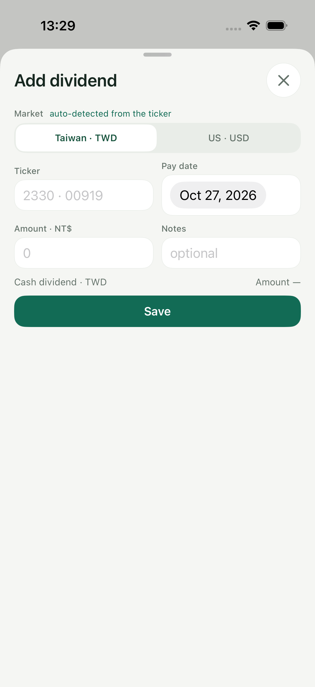
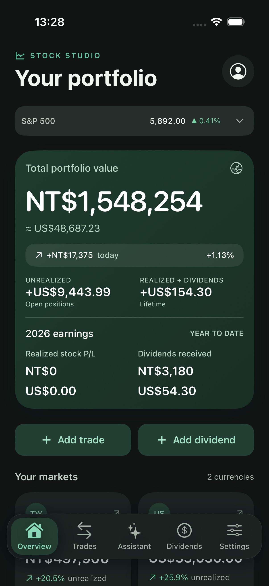
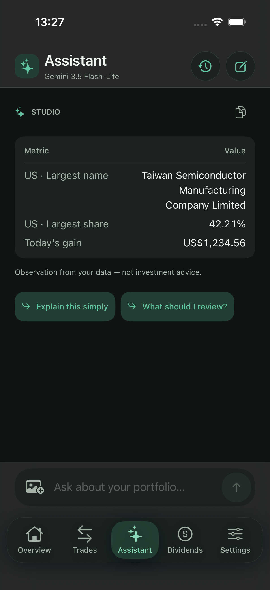
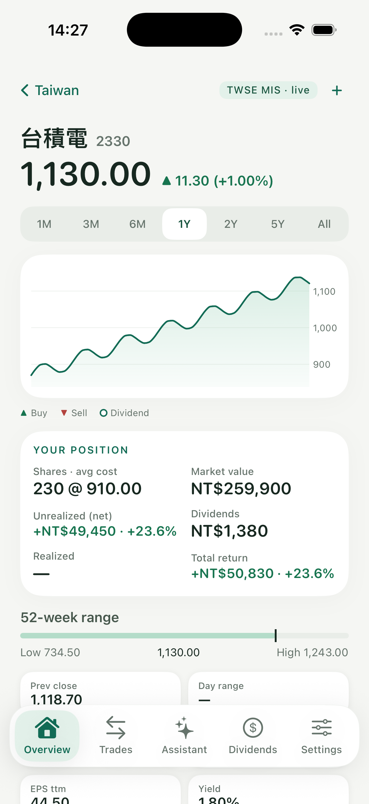
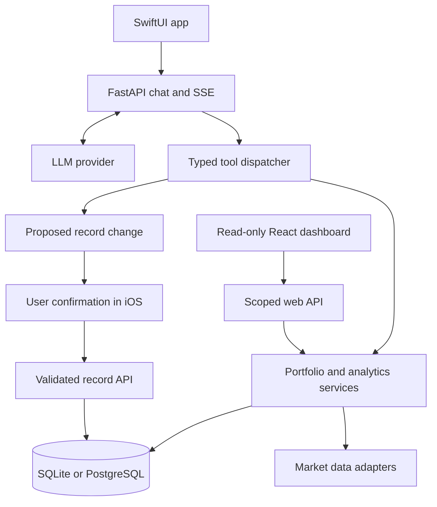

<div align="center">

# AI Stock Studio

**Portfolio tracking and AI assistance for Taiwan and US stocks.**

A personal project for managing Taiwan and US portfolios across a native SwiftUI app and a read-only React dashboard, backed by FastAPI. Portfolio services calculate financial results; an AI assistant queries those services and proposes record changes for user review.

[](https://github.com/jimmy19981226/stock-tracker/actions/workflows/ci.yml)


[Product tour](#product-tour) · [Engineering decisions](#engineering-decisions) · [Architecture](#architecture) · [Run locally](#run-locally) · [Tests](#verification) · [Review guide](#review-guide)

</div>

**Personal project by [James Chen](https://github.com/jimmy19981226).**

**Start here:** [See the app](#product-tour), [review the design decisions](#engineering-decisions), or [trace the code and tests](#review-guide). Portfolio tracking runs without an AI key; assistant features require a configured provider.

## Why this project

Tracking a portfolio across Taiwan and US markets means reconciling different currencies, cost-basis methods, trade dates, and dividend payments. Adding conversational AI introduces another challenge: explanations must stay tied to account data, and a proposed trade must remain a draft until the user confirms it.

AI Stock Studio brings these workflows into one self-hosted application. Its core engineering concerns are consistent accounting across API consumers, explicit boundaries around AI actions, and recovery when a mobile connection or external provider fails.

| Layer | Stack and responsibility |
| :--- | :--- |
| iOS | SwiftUI, WidgetKit, Keychain; portfolio management, assistant conversations, and record confirmation |
| Web | React and Vite; responsive, read-only portfolio dashboard |
| Backend | Python, FastAPI, SQLAlchemy; account-scoped APIs, accounting, analytics, and AI tool execution |
| Storage and integrations | SQLite by default or PostgreSQL; market-data adapters, LLM providers, and PDF reporting |
| Verification | Python unittest, native iOS unit/UI tests, and GitHub Actions for backend tests and web builds |

## Product tour

<p align="center">
  
  
  
</p>
<p align="center">
  
  
  
</p>

Screenshots use **synthetic demonstration portfolios** and fixed greeting hours. iOS version **2.0.14 (build 21)** includes light/dark appearances and five destinations: Overview, Trades, Assistant, Dividends, and Settings.

- **Personal welcome:** a local-time greeting uses the signed-in user’s first name, with “Your portfolio” retained as a smaller subtitle.
- **Portfolio accounting:** Taiwan moving-average and US FIFO cost basis, realized/unrealized P&L, and current-year earnings by currency.
- **Market context:** configurable indices, stock charts, dated performance windows, and benchmark comparisons.
- **AI assistance:** portfolio queries, readable tables, editable follow-ups, and confirmation cards for proposed record changes.
- **Daily workflows:** trade and dividend entry, imports, PDF reports, and a WidgetKit snapshot.

[Full feature reference](docs/FEATURES.md) · [Screenshot gallery](docs/GALLERY.md) · [iOS setup and release details](ios/README.md)

## Engineering decisions

| Problem | Implementation and tradeoff | Code and evidence |
| :--- | :--- | :--- |
| A sale's profit depends on earlier purchases, including buys outside the requested reporting window. | Shared backend accounting services apply Taiwan moving-average or US FIFO rules before filtering realized results. This keeps historical cost basis available to summaries, reports, and tools. | [Accounting service](backend/app/services/portfolio.py) · [Reconciliation tests](backend/tests/test_portfolio_accounting.py) |
| An AI-generated record change should not silently alter the ledger. | Record tools return validated proposals. iOS shows a confirmation card and submits approved changes through ordinary record APIs. This adds a review step while keeping persistence outside the model's tool execution. | [Tool dispatcher](backend/app/services/ai_tools.py) · [iOS proposal model](ios/StockTracker/Models/RecordProposal.swift) · [Proposal tests](backend/tests/test_ai_agentic.py) |
| Backgrounding a phone can disconnect a slow AI response. | Generation runs in a detached server thread; SSE delivers progress and response events, and finished replies are persisted for history recovery. Active runs remain process-local, so a server restart can interrupt them. | [Chat lifecycle](backend/app/routers/ai.py) · [Disconnect and cancellation tests](backend/tests/test_ai_lifecycle.py) |
| Missing prices and paginated records can produce plausible but incomplete answers. | Dated analytics validate required history, filtered totals cover the full result set, and supported numeric answer formats resolve values from tool results. Unavailable data is surfaced explicitly; these checks do not verify every free-form model statement. | [Analytics](backend/app/services/ai_analytics.py) · [Answer checks](backend/app/services/ai_answers.py) · [Known-answer tests](backend/tests/test_ai_analytics.py) |

**Concrete accounting example:** the [synthetic ledger test](backend/tests/test_portfolio_accounting.py) buys 10 shares at 100 with a fee of 2, buys 10 at 200 with a fee of 2, then sells 10 at 250 with a fee of 1. The app calculates realized profit of **997 using moving average** and **1,497 using FIFO**, in the ledger's currency. Tests carry those rules through holdings, year-to-date summaries, sale simulations, and reports.

## Architecture



**Read → calculate → explain.** The assistant can request holdings, filtered records, purchase lots, performance, fundamentals, and reports. The backend performs account arithmetic and returns structured results. This makes the calculation path inspectable independently of model output.

**Propose → review → commit.** Tool-generated writes are proposals. Confirmation cards let the user review additions, corrections, deletions, and imports before ordinary record endpoints persist them.

**Stream → reconnect.** Server-side chat runs stream status and response events to iOS, with persisted chat history and support for background completion. Regression tests exercise the transport, tool execution, data scoping, and calculation paths with synthetic account data.

The iOS client is configured to use `gemini-3.5-flash-lite`; the backend also contains other provider adapters. Provider availability, model output, and market feeds remain external dependencies.

## Run locally

### Backend

Use **Python 3.11+**. SQLite is the default; a PostgreSQL connection is optional.

```bash
git clone https://github.com/jimmy19981226/stock-tracker.git
cd stock-tracker/backend
python -m venv .venv
source .venv/bin/activate
python -m pip install -r requirements-dev.txt
cp .env.example .env
# Edit .env and set WEB_DASHBOARD_PASSWORD to a password of your choice.
python -m uvicorn app.main:app --reload --port 8011
```

On Windows, activate with `.venv\Scripts\Activate.ps1`. Open the [local API explorer](http://127.0.0.1:8011/docs) or check `GET /api/health`. A fresh local database starts empty. Add your own records through the iOS client or the API explorer.

### Web dashboard

In another terminal, from the repository root:

```bash
cd frontend
npm ci
npm run dev
```

Open **http://localhost:5173** and enter the dashboard password. Vite forwards `/api` requests to `http://127.0.0.1:8011`. The web client reads the account scope configured by `WEB_DASHBOARD_USER_ID`, which defaults to `legacy`.

### iOS and optional AI

Generate the project with XcodeGen, open it in Xcode, and set the app's backend URL to your own instance before entering records. The repository's existing app configuration includes a hosted default URL. See the [iOS setup guide](ios/README.md).

Portfolio tracking can run without an AI provider key. In iOS Settings → AI assistant, choose Included AI for the server-managed Gemini connection, or Personal key to use your own key. Switching to Included AI preserves your saved key but does not send it. Follow the backend environment example to configure server-managed access. Request content used by AI features is sent to the selected provider.

## Verification

```bash
# From backend/, with the development dependencies installed:
DATABASE_URL=sqlite:///:memory: RUN_GEMINI_LIVE_TESTS=0 python -m unittest discover -s tests -v

# From frontend/:
npm ci
npm run build
```

The backend suite covers account isolation, market-specific accounting, year-to-date earnings, tool calls, confirmation proposals, image handling, exact dated returns, credential failures, Unicode passwords, and token expiry/rotation. Ordinary runs skip the explicitly opt-in live Gemini tests. CI runs the backend tests and a clean web build; native iOS tests require Xcode.

<details>
<summary>Previously recorded local verification — 2.0.14 (October 27, 2026)</summary>

These are release verification results, not a live report of the current checkout. Use the commands above and the linked CI workflow to check a new revision.

| Check | Result |
| :--- | :--- |
| Backend, isolated SQLite | 128 passed; 12 opt-in live tests skipped |
| iOS unit tests | 56 passed |
| iOS UI regression checks | 18 distinct cases across targeted runs: product tours, YTD layout, navigation, form cancellation, chat, index rotation, retry, and personalized greetings |
| Release build | iPhone release build succeeds; 2.0.14 (21) installed on device |
| Live OTC data | Official quote and rolling one-month chart history verified through the hosted API |

The previous assistant verification passed 22 distinct UI cases. All 12 live
Gemini scenarios passed at least once; three initially hit provider rate limits
and passed a single paced retry. These are separate from the offline suite.
Live checks consume provider quota and use synthetic records. They do not prove
permanent provider availability or eliminate the slow responses observed on the
hosted service. Run native tests using the [preview/test guide](ios/DesignPreview/README.md).

</details>

## Review guide

| Review question | Follow this path |
| :--- | :--- |
| How does a prior-year purchase affect a current-year sale? | Start with the ledger example above, then inspect [accounting](backend/app/services/portfolio.py) and [reconciliation tests](backend/tests/test_portfolio_accounting.py). |
| What prevents an assistant draft from changing the ledger? | Follow [tool dispatch](backend/app/services/ai_tools.py) → [iOS proposal](ios/StockTracker/Models/RecordProposal.swift) → [record API](backend/app/routers/trades.py); [tests](backend/tests/test_ai_agentic.py) compare the ledger before and after confirmation. |
| What happens when the phone disconnects? | Inspect [chat runs and persistence](backend/app/routers/ai.py) and [lifecycle tests](backend/tests/test_ai_lifecycle.py). A disconnected client and a restarted server have different recovery guarantees. |

For a product demo, use synthetic records: inspect a holding, ask the assistant about account data, then review and dismiss a proposed trade. The ledger should remain unchanged. The [gallery](docs/GALLERY.md) provides a walkthrough without a running backend.

**Next design steps:** durable background jobs would address interrupted server processes, and a stricter authentication policy would replace compatibility guest mode before supporting untrusted users. These remain future improvements.

## Code guide

| Start here | What to inspect |
| :--- | :--- |
| [`ai_tools.py`](backend/app/services/ai_tools.py) | Tool schemas, dispatch, and proposed actions |
| [`ai_analytics.py`](backend/app/services/ai_analytics.py) / [`ai_answers.py`](backend/app/services/ai_answers.py) | Filtered analysis and supported numeric answer checks |
| [`ai.py`](backend/app/routers/ai.py) | Chat lifecycle, streaming, and provider integration |
| [`portfolio.py`](backend/app/services/portfolio.py) / [`performance.py`](backend/app/services/performance.py) | Market-specific accounting and dated performance calculations |
| [`backend/tests/`](backend/tests/) | Integration tests with isolated databases and stubbed external services |
| [`ios/`](ios/) / [`frontend/`](frontend/) | Native app and browser dashboard |

## Deployment boundaries

The backend retains a **guest/legacy account** for local and single-user operation. The web dashboard password protects `/api/web/*`; it does not lock every backend endpoint. The first verified Google account can adopt legacy records. Review these behaviors in [development and deployment notes](docs/DEVELOPMENT.md) before exposing a real portfolio on a public server.

Market feeds may be delayed or unavailable, historical coverage varies, and brokerage fee/tax assumptions may differ from your records. AI output and portfolio metrics support personal analysis; verify consequential decisions against authoritative records.

## Documentation

| Guide | Purpose |
| :--- | :--- |
| [Feature reference](docs/FEATURES.md) | Detailed product capabilities |
| [Screenshot gallery](docs/GALLERY.md) | Current iOS tour and web dashboard |
| [Development and deployment](docs/DEVELOPMENT.md) | Configuration, trust boundaries, tests, and contribution workflow |
| [iOS setup](ios/README.md) | XcodeGen, simulator/device setup, and assistant configuration |
| [Web setup](frontend/README.md) | Dashboard authentication and deployment |
| [Windows self-hosting](docs/SELF_HOSTING_WINDOWS.md) | Existing Windows deployment workflow |
| [Taiwan quote relay](docs/TW_QUOTE_RELAY.md) | Optional quote relay configuration |
