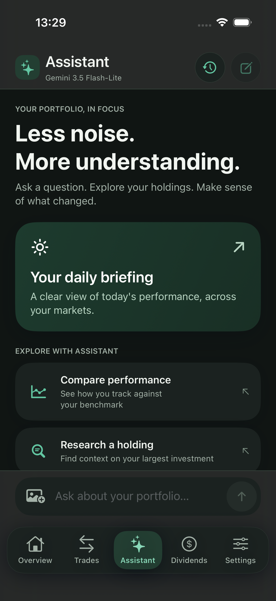
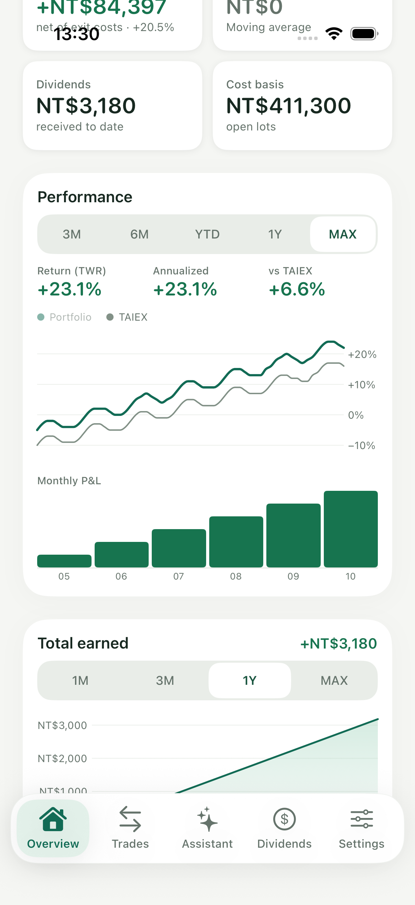
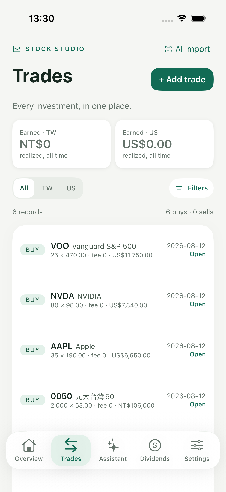
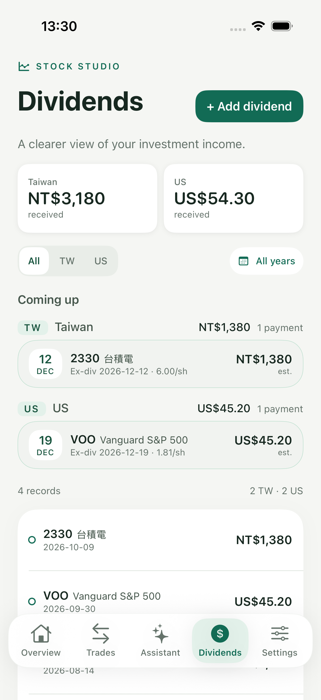
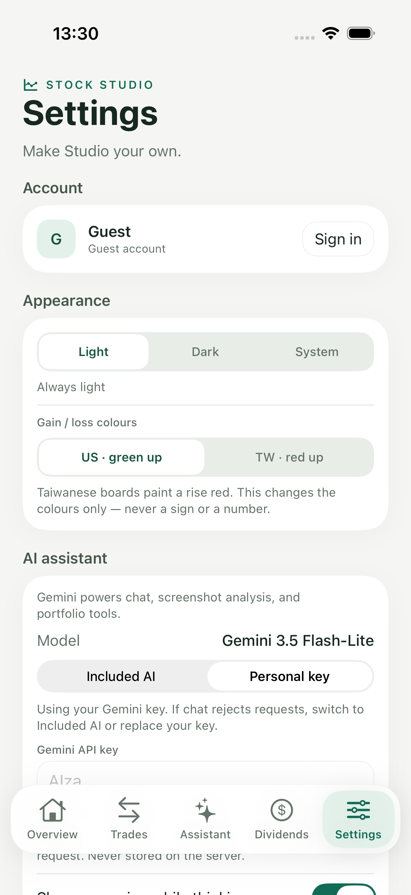
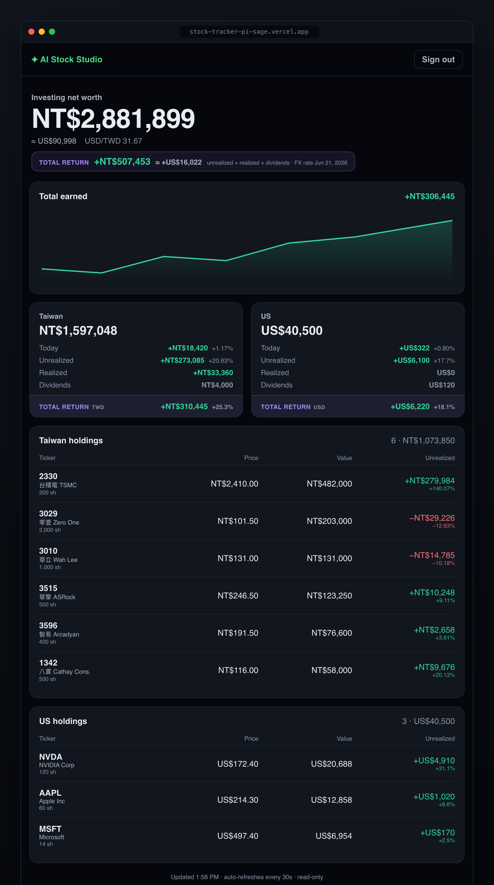

# Product gallery

Stock Studio **2.0.14 (build 21)**. These iOS screenshots show the
current design using synthetic records and fixed greeting hours; they are not a real portfolio
or examples of guaranteed investment returns. [Back to overview](../README.md).

## Portfolio and dividend entry

## Assistant

## Holdings and records

The tours also verify keyboard navigation, record-form cancellation, assistant
prompt editing, and the year-to-date card. Reproduce them using
[DesignPreview](../ios/DesignPreview/README.md). Runtime provider responses are
verified separately from these deterministic UI demonstrations.

## Web dashboard

The read-only web client retains its separate visual design. This web screenshot
is separate from the iOS 2.0.14 tour.

